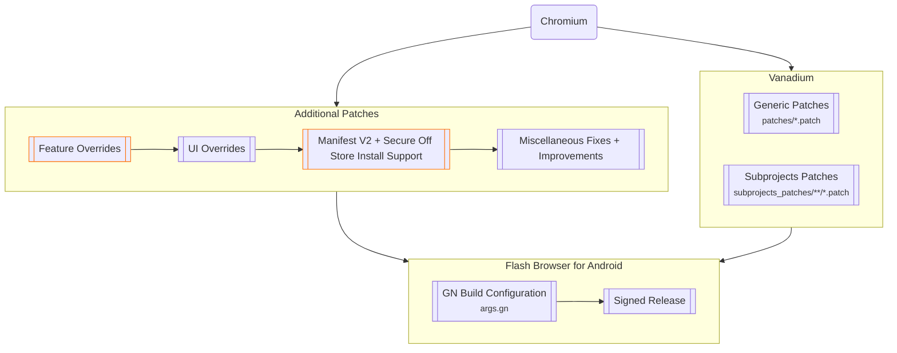

# Flash Browser for Android

[](https://github.com/jqssun/android-titanium-browser)
[](https://github.com/jqssun/android-titanium-browser/releases)
[](https://github.com/jqssun/android-titanium-browser/blob/main/LICENSE)
[](.github/automation/README.md)
[](https://github.com/jqssun/android-titanium-browser/releases)

Flash Browser is a rebranded fork of [**Titanium Browser for Android**](https://github.com/jqssun/android-titanium-browser), a secure and fully open-source, Chromium-based web browser with support for extensions. Titanium is based on [Vanadium](https://github.com/GrapheneOS/Vanadium) by [GrapheneOS](https://github.com/GrapheneOS). To maintain a fast and native experience for everyone, advanced features are modularized into [**Titanium Extension for Android**](https://github.com/jqssun/android-titanium-extension).

The upstream Titanium builds are published in the [**Titanium Releases**](https://github.com/jqssun/android-titanium-browser/releases/latest). Builds from this fork are produced by its own release workflow.

[](https://play.google.com/store/apps/details?id=io.github.jqssun.helium)
[](https://github.com/jqssun/android-titanium-browser/releases/latest)


## Usage

### Installing Extensions

You can install extensions from the following sources:
- [Chrome Web Store (Recommended)](https://chromewebstore.google.com/)
- [Opera Add-ons](https://addons.opera.com/)
- [Microsoft Edge Add-ons](https://microsoftedge.microsoft.com/addons/)

You can also install from local CRX (or ZIP) file in the options page of the built-in [**Titanium Extension for Android**](https://github.com/jqssun/android-titanium-extension). 

Additionally, you can load an unpacked extension manually for testing purposes by navigating to [`chrome://extensions`](chrome://extensions). Enable **Developer mode**, select **Load unpacked**, and choose the folder containing the extension in the Storage Access Framework (SAF) picker. It may take a moment for the extension to load.

### Using Extensions

To run an extension in Incognito (OTR) mode, go to **Manage extensions**, find the extension you want to use in Incognito mode, select **Details**, and turn on **Allow in Incognito**.

For advanced features including external download manager, enhanced dark mode, and additional privacy options, you can use the built-in [**Titanium Extension for Android**](https://github.com/jqssun/android-titanium-extension).

### Debug URLs

To view and access the debug URLs, use [`chrome://chrome-urls`](chrome://chrome-urls). For **Experiments**, use [`chrome://flags`](chrome://flags).

### WebRTC IP Policy

The option is available by using the menu button <kbd>⋮</kbd> in the top right corner, then selecting **Settings**, **Privacy and security**. If you experience issues with WebRTC due to IPs being shielded by default (e.g. [Discord Voice](https://discord.com/blog/how-discord-handles-two-and-half-million-concurrent-voice-users-using-webrtc)), try changing it to **Default public interface only**, or **Default**.

## Implementation

> [!WARNING]
> [Flash Browser for Android](#flash-browser-for-android) only attempts to improve security and privacy where possible. For better protection on Android, you should instead use [GrapheneOS](https://grapheneos.org) with [Vanadium](https://vanadium.app), which additionally integrates patches into Android System WebView and provides significant kernel and memory management hardening on the OS level.



## Building

The [**Chained build**](.github/workflows/chained-build.yml) workflow compiles
the ARM64 `chrome_public_apk` across several dispatched jobs, carrying the
prepared checkout and `out/Default` between them on the `build-cache` release.
Start it once with `action=continue` and `auto_chain=true`: each session that
runs out of time queues the next one, and the chain stops when an APK exists.

The build job compiles with `SIGN_RELEASE=false`, so the release key never enters
a six-hour unattended job. A session that ends with an APK uploads it as the
`titanium-arm64-unsigned` artifact, and the short `publish` job — which runs only
when that artifact exists — signs it and creates the GitHub release.

Signing material goes to the `release` environment as `RELEASE_KEYSTORE_B64`
(base64 of the PKCS12 keystore) and `RELEASE_LOCAL_PROPERTIES_B64` (base64 of a
`local.properties` defining `storePassword`, `keyPassword` and `keyAlias`); the
keystore itself is never committed. `vars.RELEASE_CERT_SHA256` is optional and
makes the job refuse an APK whose signer certificate does not match it;
`vars.KEYSTORE_TYPE` defaults to `PKCS12`. Until both secrets exist the job
publishes the unsigned build instead, as the prerelease
`titanium-<version>-unsigned`; with them the tag is `titanium-<version>` and the
APK installs as-is. Required reviewers on that environment make every signature a
manual approval.

Runner labels, environments and the complete setup checklist are in
[the automation guide](.github/automation/README.md#setup).

If a chain finished and left only the unsigned APK behind, dispatch
`action=sign`: it skips the build job entirely, takes the APK from the newest
`titanium-<version>-unsigned` release, signs it and publishes `titanium-<version>`.
The session that completes a build also saves its cache generation, so a later
`action=continue` restores a tree that already contains the APK and goes straight
to publishing instead of replaying the last few hours of compilation.

Current releases can be attested using [GitHub CLI](https://github.com/cli/cli):

```shell
gh attestation verify *.apk -R jasav24/android-titanium-browser
```

This repository also provides `build.sh` to compile on Linux (the latest Ubuntu
is the supported CI baseline). Upstream synchronization, protected-UI review,
full-build gating and release/rollback procedures are documented in
[`.github/automation/`](.github/automation/README.md).

## Credits

This project would not have been possible without the huge community contributions from [Vanadium](https://github.com/GrapheneOS/Vanadium), and without the privacy-focused, open-source approach shared by various other Chromium projects. All credit goes to the original authors and contributors. This project started around the same time as [Helium Browser for Linux](https://github.com/imputnet/helium-linux) but it is not affiliated with the desktop Helium project.